# [MDI 1.7.2](https://github.com/Altronic-LLC/Altronic-Public-Files/blob/main/ACM4000_Releases/PR/mdi/mdi-1.7.2/mdi-1.7.2.atf)

> **Copyright (c) 2026. All rights reserved.**  
> Altronic, LLC  
> 712 Trumbull Avenue  
> Girard, Ohio 44420  
> United States of America

## Release Kind: Preview Release

For demonstration and shakedown. May contain incomplete features, 
bugs of various severity.

## Intended Use and Users

An early release intended for internal testing and evaluation. Not
validated for deployment on production systems; not for sale or general
distribution.

This release supersedes [MDI 1.7.1](https://github.com/Altronic-LLC/Altronic-Public-Files/blob/main/ACM4000_Releases/PR/mdi/mdi-1.7.1/), [MDI 1.7.0](https://github.com/Altronic-LLC/Altronic-Public-Files/blob/main/ACM4000_Releases/PR/mdi/mdi-1.7.0/) and [MDI 1.6.3](https://github.com/Altronic-LLC/Altronic-Public-Files/blob/main/ACM4000_Releases/PR/mdi/mdi-1.6.3/). It contains **every change made since MDI 1.1.17**, so a unit on 1.1.17 can go straight to 1.7.2.

#### Versioning:
- **MDI:** 1.7.2
- **Master AWI:** 2.0.7
- **Update Service:** 0.2.4 (new - installed automatically with this release)

---

## Before You Update

> [!IMPORTANT]
> **The Master AWI is replaced with version 2.0.7.** Installing 1.7.2 always puts the Master AWI that ships with this release (2.0.7) on the unit. If you uploaded your own Master AWI, upload it again after the update (Settings > Upload Master AWI). Device AWIs and dashboards are not affected.

> [!NOTE]
> **Your SCADA or PLC may now report a communication fault that it did not report before.** If the ACM-4000 shares data from a device that has stopped answering, it now tells the system reading it (Modbus slave on TCP port 502 or an RS-485 port in slave mode) that the device is not responding, instead of repeating the last good values. This starts after the longer of 10 seconds or three missed polls. This is intended: frozen data no longer looks like live data. See [What's New in 1.7.2](#whats-new-in-172).

> [!NOTE]
> **Device timing settings now have limits.** Poll Delay is limited to 10,000 ms, Poll Frequency to 3,600,000 ms (1 hour), Poll Count to 2,000 and the RS-485 timeout to 10,000 ms. Node Id must be between 1 and 255. A value outside these limits is pointed out when you edit the device.

---

## At a Glance

The ACM-4000 screen with a device as the Main Device, showing live values:

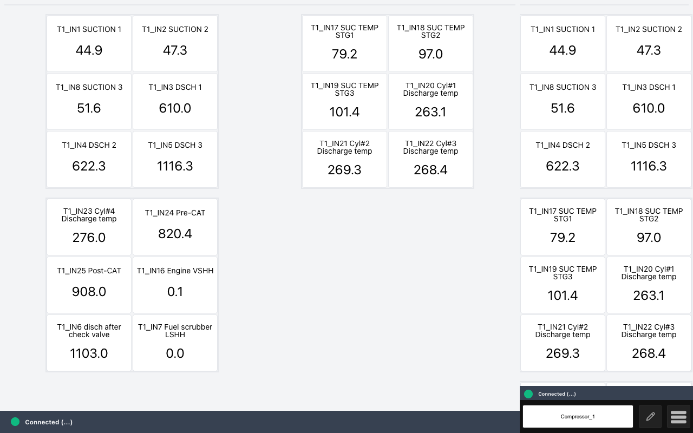

**New in 1.7.2 (since 1.7.1):**
- Safer software updates, from a USB drive or over the network, on every ACM-4000
- Reset to Factory now works
- Clearer messages when a setting or file is not accepted, and nothing is changed by a bad file
- The Live Data Viewer tells you what happened to every write
- Wi-Fi connection status on the Settings page
- Saving network settings no longer interrupts devices that were not changed
- More reliable RS-485 readings, datalogging and exports
- A clear message when no Main Device is chosen

**If you are updating from 1.1.17**, you also get everything listed under [Everything Since 1.1.17](#everything-since-1117), including user logins and permissions, editing dashboards and registers right on the unit, the Live Data Viewer, viewing the screen from a PC, and many stability fixes.

---

## What's New in 1.7.2

### Software Updates

#### Safer Updates, On Every Unit
Software updates are now handled by a new update service on the ACM-4000. Before anything is installed, the unit checks the update file and shows you exactly what it will install. Nothing changes until you press **Install**.

- **Upload Firmware** lets you send an update file from a PC's web browser on the same network. This now works on **every** ACM-4000, including legacy units, which previously could only update from a USB drive.
- **Update from USB Drive** works as before: insert the drive, press **Check for drive**, choose the file.
- Older update files (MDI 1.7.1 and earlier) can still be installed.
- If an update is interrupted, for example by a power loss, it can simply be installed again; the unit no longer stays stuck as "busy".

**System Info > Upload Firmware / Update from USB Drive:**

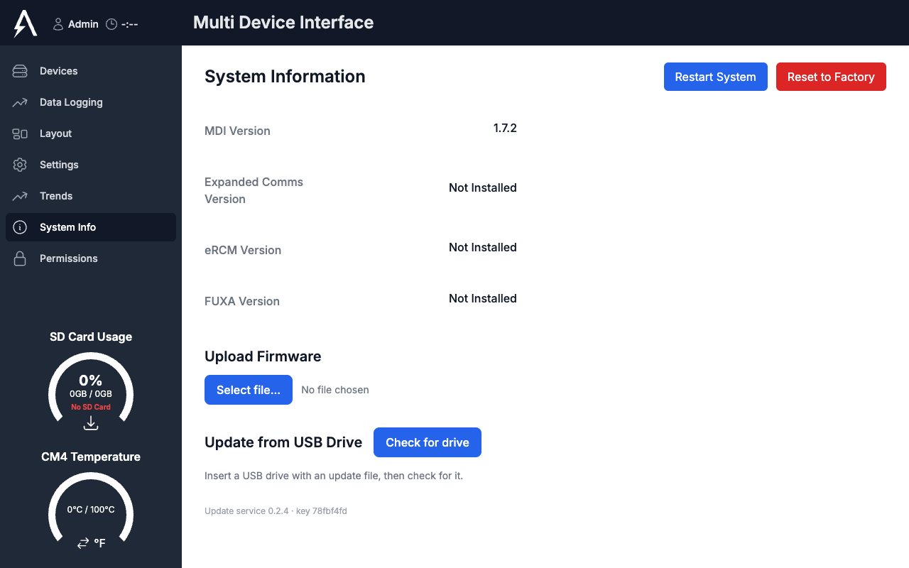

**After you choose a file and press Send to unit, the unit shows what it will install.** Press **Install and restart** to go ahead, or **Choose another** to pick a different file:

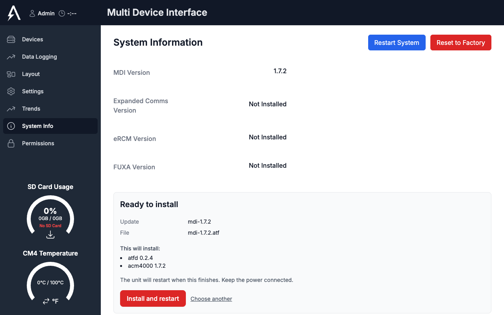

> [!NOTE]
> Updates built in the new signed format also show the line "This package has been checked and is genuine Altronic software." Older update files, such as 1.7.2 itself, do not show this line.

#### Reset to Factory Now Works
The **Reset to Factory** button on System Info, first announced in 1.7.0, now works. It returns the unit to the state it shipped in, keeping the installed software. To prevent accidents you must type **RESET** before the button is enabled. The unit restarts on its own and comes back at its default address (98.102.65.175) with the first-run prompt about a minute later.

What is erased: all devices, dashboards, layouts, permissions and MDI passwords, the network settings, and the datalog history on the SD card. Data you already exported is kept.

The button is available to every user, so that a unit with lost passwords can always be recovered. The typed **RESET** is the safeguard.

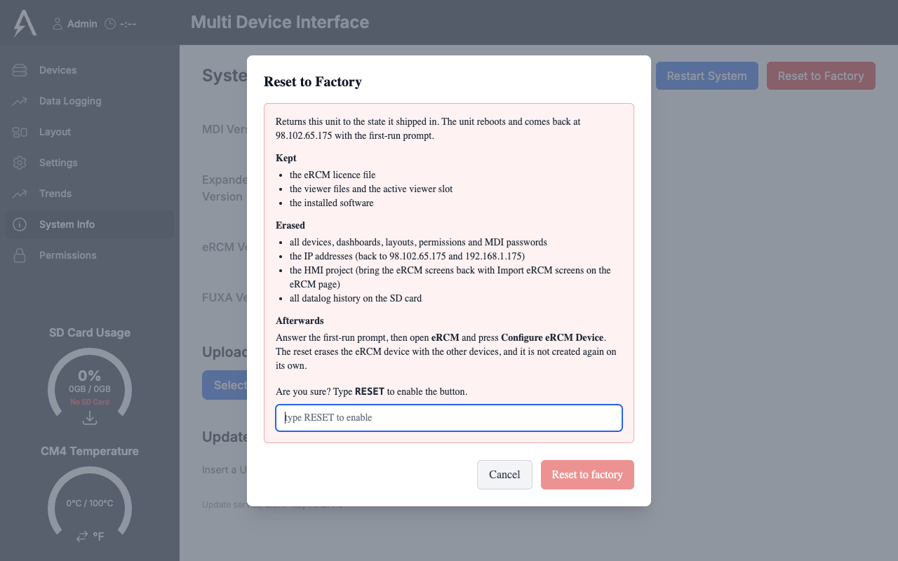

> [!NOTE]
> The lines in this window that mention eRCM only apply to units with eRCM installed.

### Devices

#### Clearer Messages When Something Is Not Accepted
The Device Settings window now explains exactly what is wrong with a value and how to fix it, for example "Poll Delay must be a whole number of milliseconds between 1 and 10000". A save that fails keeps the window open and says why, instead of closing as if it had worked.

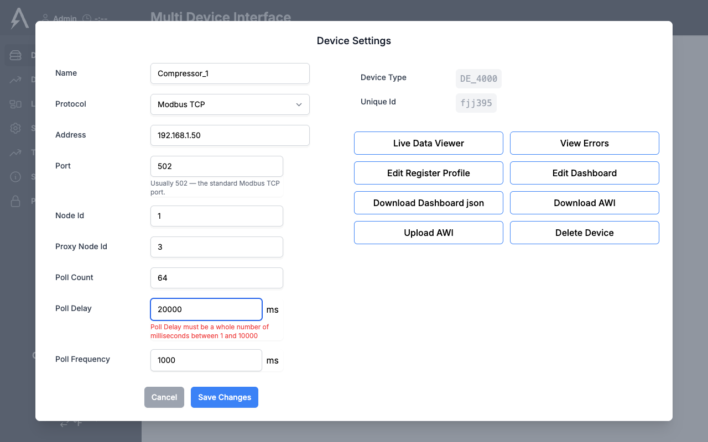

Other improvements on the Devices page:
- **Two RS-485 devices on the same port and Node Id** now show a warning on the device card and in Device Settings, so a wiring or addressing mistake is easy to spot. You can still save.
- **Device names** are limited to 32 characters, and long names no longer push the page out of shape.
- **An AWI you downloaded with Download AWI can be uploaded again.** Previously the unit refused it.
- **When an AWI file is refused**, the message says why (for example the file holds no device data, is saved in the wrong text format, or its device type does not match its registers), and no device is added.
- **Deleting a device** now removes everything that belonged to it, including its error history.
- **Live values stay with the right device.** Switching to a device that is unplugged no longer briefly shows another device's values, large values are correct the first time they appear, and a screen keeps updating after a device's AWI is uploaded again.

#### Live Data Viewer: You Always Know What Happened to a Write
When a write to a register fails, the row now shows the reason as text, which is easy to read on the touchscreen. After a write is accepted, the unit reads the register again; if it reads something else, the viewer tells you ("Written X; the register reads Y. Something else is writing it.").

A register set to **View** on the Permissions page can no longer be written from the Live Data Viewer or the dashboard editor.

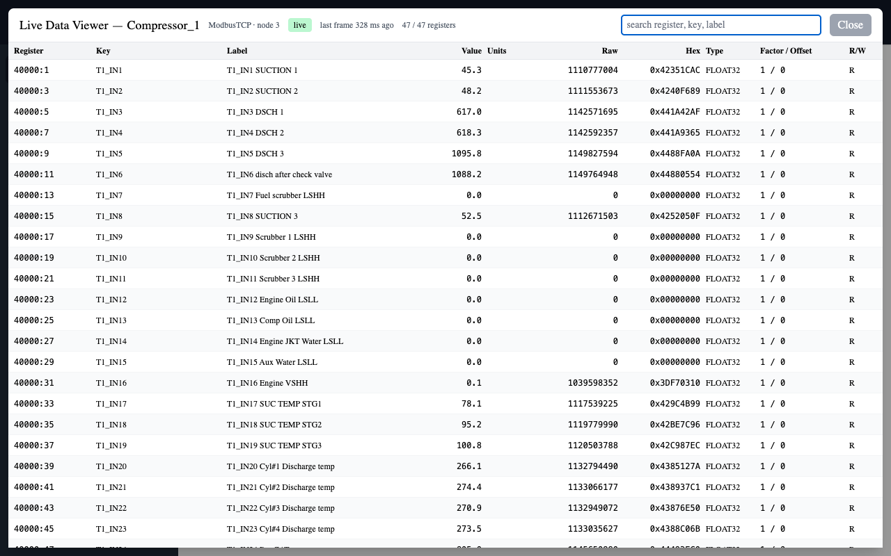

### Settings and Network

#### Wi-Fi Connection Status
The Settings page now shows the Wi-Fi status under **WiFi Mode**: Connected, Connecting..., Failed to connect, Access point is up, or Wi-Fi is disabled.

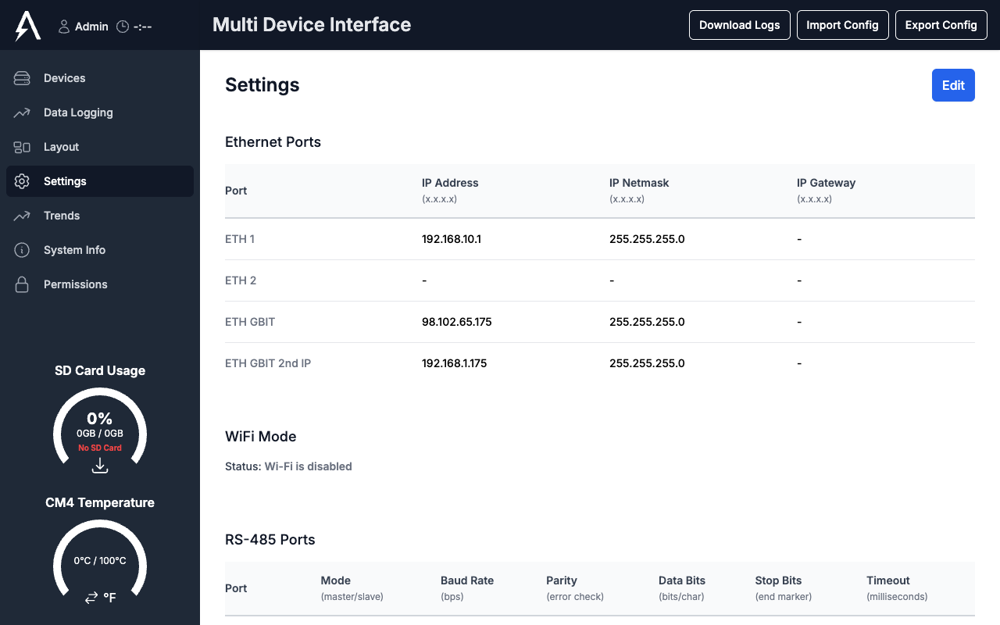

#### Saving Network Settings No Longer Interrupts Your Devices
Saving the network settings now only touches the ports you actually changed. A Wi-Fi change no longer takes the Gigabit Ethernet port down for 10-20 seconds, an Ethernet change no longer restarts the Wi-Fi access point several times, and saving without changes restarts nothing. Device communication continues while you work.

#### Other Settings Improvements
- **Screen Sleep Timer** takes whole minutes from 0 to 1440, and **Screen Zoom** takes 50 to 300 %, with a clear message if the value is outside that range. Screen Zoom no longer says a power cycle is needed.
- **Bridging** Ethernet ports now needs at least two ports, and says so.
- **IP addresses** with leading zeros (such as 010.0.0.1) are refused everywhere, with a message showing the correct way to write them.
- **Additional HTML files** are available as soon as they are uploaded, without a restart.
- **Upload Master AWI** refuses a file that is not a Master AWI, and changes nothing when it refuses.
- **CM4 Statistics** turned on or off takes effect on every open screen without reloading.
- **Saving settings keeps your Datalog interval.** In 1.7.1, saving any setting could reset the logging interval to 5 seconds until the next restart.

### Data, Export and Import

- **Import Config checks the file first.** A file that is not a configuration backup for this unit is refused with "Nothing was changed". Previously a wrong file could erase the configuration and still report success.
- **Export Data** (press the download icon under the SD Card Usage gauge) checks a custom date range before exporting and explains the problem, for example a start month after the end month, or no data for the selected devices.
- **"Delete stored data after export"** now only deletes the months that were exported, and only after the export succeeded.
- **Cleaner exported CSV files.** Each daily CSV now holds only the time and the logged values, so it opens directly in Excel or other tools. Months that were already partly exported before the update may still contain some files in the old layout.
- **The SD card gauge shows the card as full** when less than 2.1 GB is free, matching the point at which the unit starts making room.

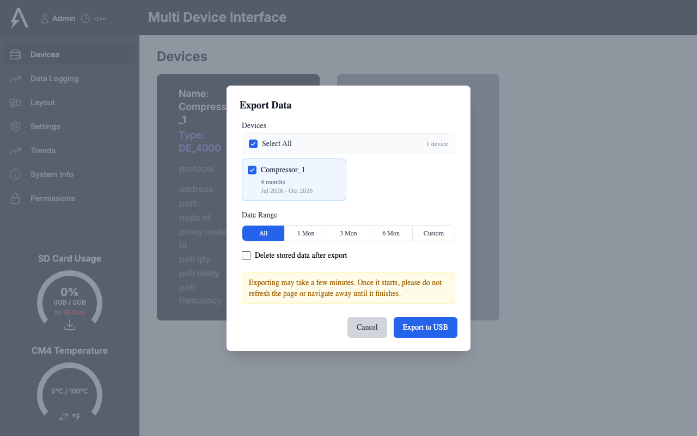

### Communications

- **Dead devices are reported to your SCADA or PLC.** See [Before You Update](#before-you-update).
- **RS-485 readings stay with the right register.** A late reply from a slow device could previously be taken as the answer to the next request, so values could appear under the wrong register. This is fixed.
- **Very large timing values no longer freeze device changes.** An extremely large Poll Delay used to stop every later device change until a restart. Timing values are now limited (see [Before You Update](#before-you-update)).

### Screen and Login

#### A Clear Message When No Main Device Is Chosen
If no Main Device is selected, the screen now explains how to choose one, instead of showing a DE-4000 connection error. New and factory-reset units start this way unless DE-4000 is chosen on the first-run prompt.

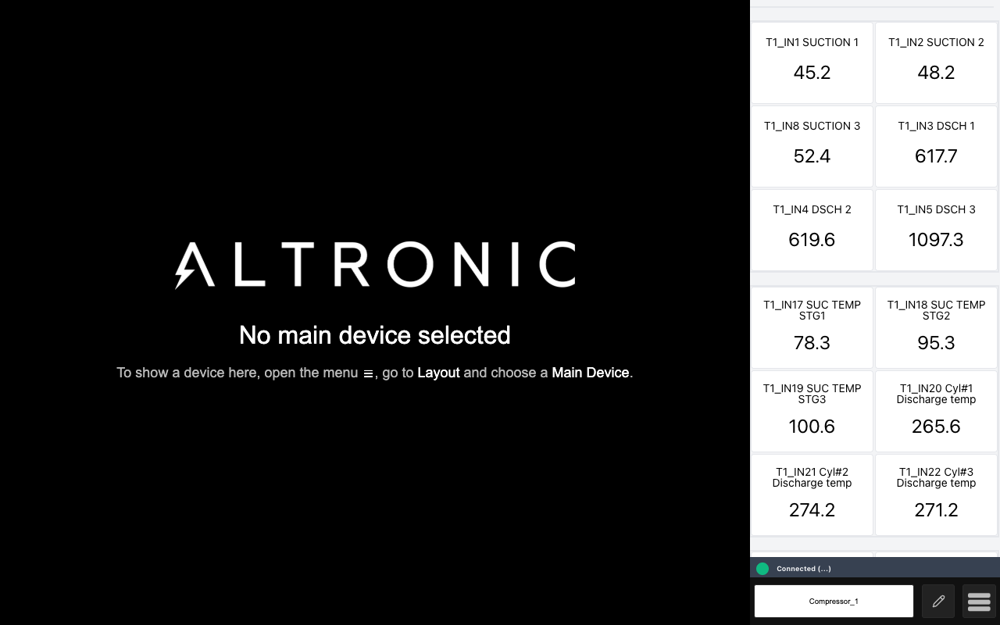

#### Other Improvements
- **Permissions apply immediately.** Saving permissions updates the AWI screens that are already open, and per-register restrictions are no longer lost when other permissions are saved.
- **Trends:** pushing or pulling a configuration now asks before replacing one, importing a configuration warns about devices this unit has no data for, and pulling a configuration that was never saved no longer clears the page.

---

## Everything Since 1.1.17

If your unit is on MDI 1.1.17, all of the following is new to it as well. These changes arrived in the 1.2 to 1.7.1 preview releases.

### New Features

#### Logins and Permissions
The unit now has user roles - **Admin**, **User** and **View Only** - each with its own password. Click the role name at the top left to log in as a different role. When the DE-4000 is the Main Device, the role follows the DE-4000 login.

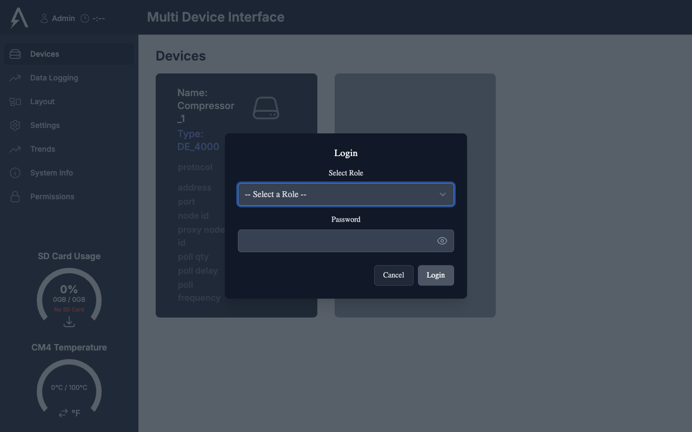

On the **Permissions** page an Admin decides, for each role, what can be edited, viewed or hidden, page by page and down to individual settings. Separate permissions cover editing dashboards, editing register profiles, and viewing and writing live data. A **Save Permissions** bar appears at the bottom of the screen whenever there are unsaved changes.

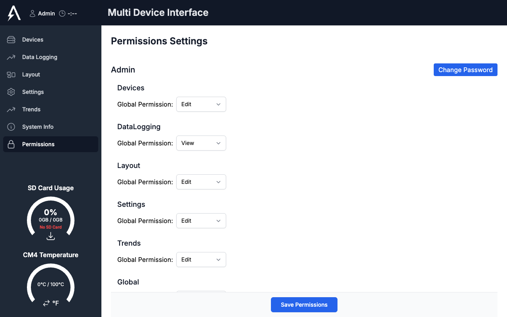

#### Edit Dashboards Right on the Unit
Rearrange a device's dashboard directly on the ACM-4000 screen, with live values, by drag and drop. No more downloading the AWI to a PC, editing it and uploading it back. Open it from **Device Settings > Edit Dashboard**, or with the pencil button next to the device buttons on the main screen. Every connected screen refreshes when you save, and **Download AWI** includes your changes.

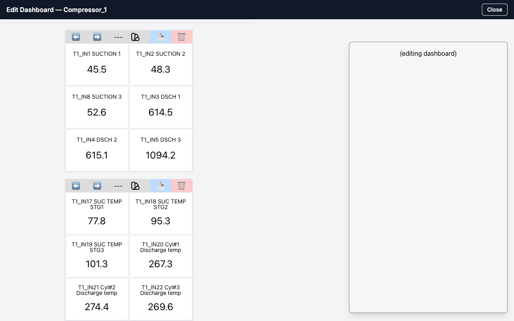

#### Edit Device Registers on the Unit
**Device Settings > Edit Register Profile** opens a spreadsheet of the device's registers. Add, remove or change registers, import them from a CSV or Excel file, or export them. Changes apply live when you press **Save & Apply Live**.

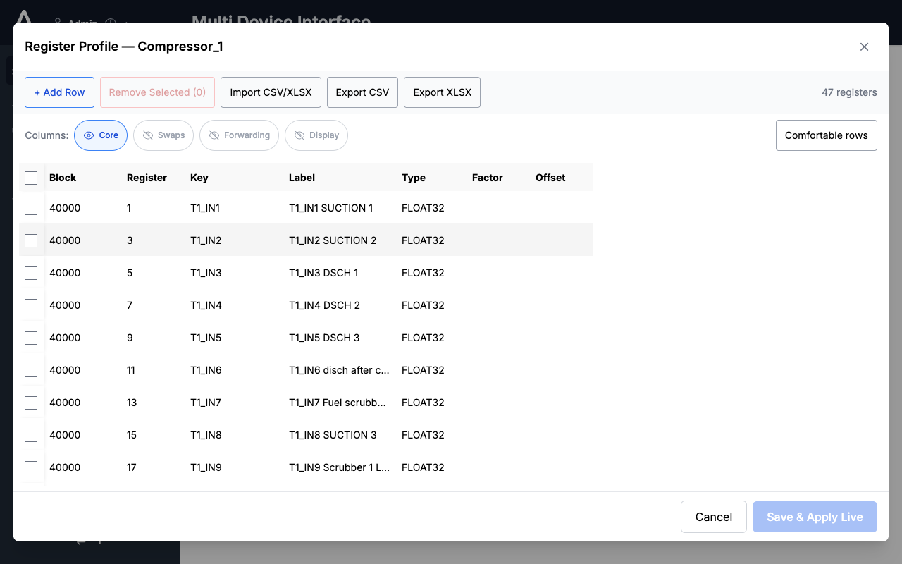

#### Live Data Viewer
**Device Settings > Live Data Viewer** shows every register of a device updating live: value, units, raw value and type. You can also write values to registers that allow it, if your role has permission.

The Device Settings window, with all the device tools in one place:

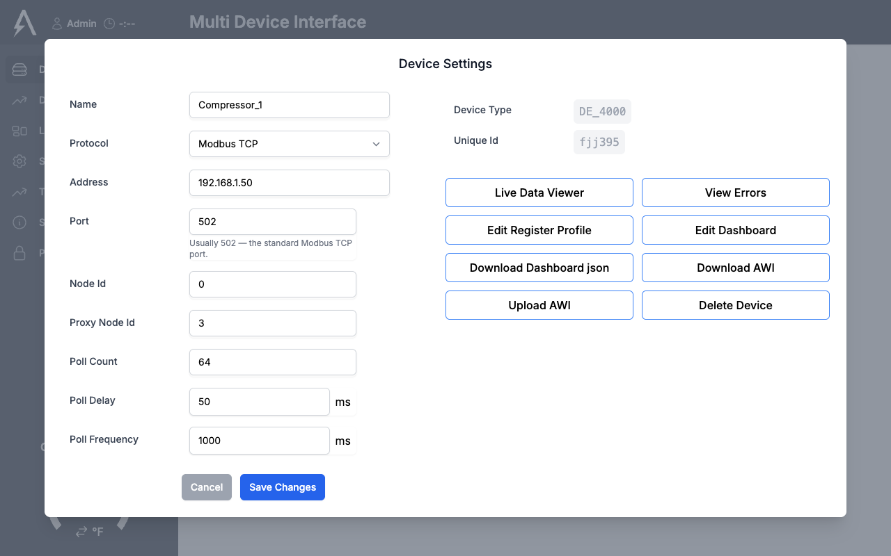

#### Restart From the Screen
**System Info > Restart System** restarts the unit after a confirmation, so a power cycle is no longer needed.

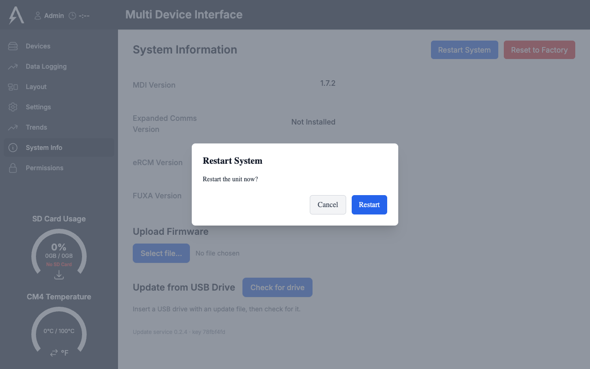

#### See and Use the Screen From Any PC
Browse to `http://<unit-ip>:6080` from a PC on the same network to see and use the ACM-4000 screen in a web browser. Nothing needs to be installed on the PC.

> [!CAUTION]
> The remote screen does not ask for a password: anyone who can reach the unit on the network can see and operate the screen. Keep the ACM-4000 on a trusted network.

#### More Ways to Get Data Off the Unit
- **Export Data** lets you choose which devices and which months to export, and save the files to a USB drive or download them straight to a connected PC.
- **SD Card FIFO** (Settings > Data Logging) deletes the oldest month automatically when the SD card runs low on space, so logging never stops. With it off, logging continues but exports stop when the card has less than 2 GB free.
- The **Trends** page was rebuilt, with a search box to find a series quickly, and downloads that use the unit's own time.

#### More Settings
- **Screen Zoom** and **Screen Sleep Timer** (Settings > HMI), applied right away.
- **RS-485 port Mode** (Master or Slave) and **RS-485 Timeout** for each port.
- **Date & Time** can be set on units that do not use a DE-4000 as the Main Device.
- **Send readings to the DE-4000 by name** (for example T1_IN1) instead of by register number, which makes DE-4000 scripts easier to write and read.
- **Byte and word order** options and signed 16-bit values for device registers.
- **Plug in a monitor while running:** HDMI can be connected without restarting the unit.
- **Edit Ethernet Settings** button on a device card when the device's address is not on the same network as any Ethernet port.
- A notice on the main screen when a device button was hidden because its device was deleted.
- Additional HTML files can be deleted from the unit.

### Improvements
- **Save buttons are always reachable:** Save and Cancel stay at the bottom of the Settings window.

  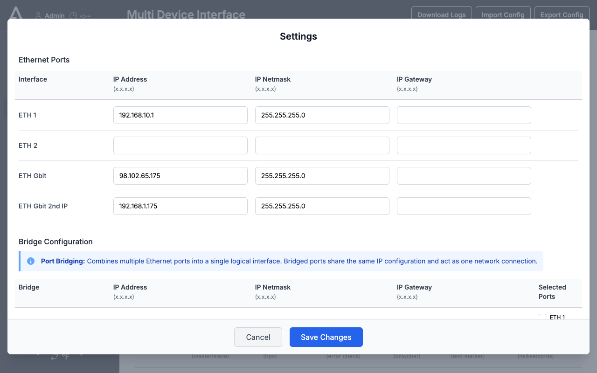

- **Settings that used to need a power cycle now take effect right away:** RS-485 port settings, Screen Sleep Timer, Screen Zoom, and registers from a newly uploaded AWI.
- **The Settings page tells you if something did not apply**, instead of always reporting success.
- **Importing a configuration keeps the unit's Master AWI.** Configuration import and export also handle much larger files.
- **Steadier Ethernet:** a power-saving feature on the Gigabit port that could briefly drop communication is turned off, and the unit checks its network settings at every power-up and corrects them if needed.
- **Smoother screen:** saving the layout or settings refreshes the screen in place instead of reloading it, and switching between devices is immediate.
- **More free memory** on legacy units, and when memory runs low the unit slows down gracefully instead of stalling. Each part of the software restarts itself within seconds if it ever stops.
- **Clock:** the unit's clock is corrected from the DE-4000 only when it has actually drifted.
- **Faster start-up** on units without an SD card, and an Altronic logo instead of a desktop while starting.
- **Updates no longer reset the Wi-Fi access point settings.**
- **The on-screen keyboard** no longer pops up for checkboxes and radio buttons.
- **Device names** use letters, numbers and underscores (for example AFR_500). Names in an uploaded AWI are converted automatically.
- **Less internal logging**, which reduces wear on the unit's built-in storage.
- **Faster, lighter communication** with Modbus TCP devices, and a device that drops off reconnects faster.

### Bug Fixes
- **Devices no longer get stuck disconnected after a power-up.**
- **One device that stops answering no longer slows down the others.** Slower devices are no longer wrongly marked as disconnected.
- **Network changes apply reliably**, including a second change saved quickly after the first.
- **Large encrypted DE-4000 program files load through the MDI.** A large file can still take the DE-4000 several minutes to process; let it finish and do not power cycle.
- **Live readings show correctly with newer AWI versions** (2.0.5 and later).
- **Dashboards stay with the right device**; a dashboard no longer appears blank or shows another device's layout.
- **The hourly SD card export no longer runs the unit out of memory**, which could leave the screen white or frozen.
- **Datalog problems no longer affect the rest of the unit**, and gaps in exported data were filled.
- **DE-4000 values with large numbers** (such as its clock value) are logged at full precision.
- **The SD Card gauge recovers on its own** once a card is inserted.
- **Coil and discrete-input addresses** were corrected for Modbus devices.
- **Also fixed:** IP address fields no longer accept invalid text, trending downloads use the unit's time instead of the PC's, and several permission problems were corrected.

---

## Where To Find This Release

### ACM-4000 bootloader update version 1.7.2

[MDI 1.7.2](https://github.com/Altronic-LLC/Altronic-Public-Files/blob/main/ACM4000_Releases/PR/mdi/mdi-1.7.2/mdi-1.7.2.atf)

## Update Instructions

> [!IMPORTANT]
> Keep the file name `mdi-1.7.2.atf`. Keep the power connected during the update. The unit restarts on its own when the update is complete.

### For ACM-4000 on MDI 1.1.x up to 1.6.x

1. **Download MDI 1.7.2**: [Download from GitHub](https://github.com/Altronic-LLC/Altronic-Public-Files/raw/refs/heads/main/ACM4000_Releases/PR/mdi/mdi-1.7.2/mdi-1.7.2.atf?download=)
2. **Prepare USB**: Copy downloaded file onto USB Flash Drive
3. **Prepare Device**: Power on ACM-4000 which you would like to update
4. **Connect USB**: Insert USB Flash Drive into ACM-4000
5. **Access Menu**: Click the Hamburger button on the MDI
6. **Navigate to System**: Click System Info
7. **Locate Update File**:
   - Click Refresh 
   - You will see the file you added to the USB
8. **Select Update**:
   - Click the checkbox for this file
   - Click update
9. **Finalize**: Once update is complete, the ACM-4000 will power cycle automatically

### For ACM-4000 on MDI 1.7.0 or 1.7.1

1. **Download MDI 1.7.2** and copy it onto a USB Flash Drive, as above.
2. Insert the USB Flash Drive into the ACM-4000.
3. Click the Hamburger button, then **System Info**.
4. Under **Update from USB Drive**, check for the drive, select `mdi-1.7.2.atf` and start the update.
5. The ACM-4000 restarts automatically when the update is complete.

### Future Updates (Once 1.7.2 Is Installed)

1. Click the Hamburger button, then **System Info**.
2. Either:
   - **From a PC on the same network:** under **Upload Firmware** press **Select file...**, choose the update file, then press **Send to unit**.
   - **From a USB drive:** insert the drive, press **Check for drive**, choose the file, then press **Send to unit**.
3. Check the **Ready to install** panel, then press **Install** (or **Install and restart**).
4. When the update finishes, the unit restarts if needed. Press **Reload this page** if the page asks you to.

### For ACM-4000 without MDI Already Installed

1. **Download MDI Image**: [Download MDI 1.0.0 from GitHub](https://github.com/Altronic-LLC/Altronic-Public-Files/blob/main/ACM4000_Releases/MDI_1.0.0-Image/MDI_1.0.0.zip?download=)
2. **Install Base Image**: Follow the [ACM Imaging Instructions](https://www.altronic-llc.com/wiki-doc/acm-4000/acm-4000-imaging-guide/) to install the base MDI system
3. **Update to Latest Version**: 
   - Once the base image is installed, follow the "For ACM-4000 on MDI 1.1.x up to 1.6.x" instructions above to update to the latest version
   - This will bring your system from version 1.0.0 to the current version

## Target, Tools, and Equipment

### Required Hardware
- ACM-4000 device
- USB Flash Drive (≥ 2GB), or a PC on the same network as the ACM-4000 (units already on 1.7.2)

### For Base Image Installation
If your ACM-4000 does not currently have the MDI installed, you will need:

- **Software Tools**:
  - RPIboot utility
  - Raspberry Pi Imager application
  - MDI 1.0.0 base image file
- **Additional Hardware**:
  - USB-A to USB-C Cable from PC(USB A) to ACM-4000(USB-C) connected to USB OTG Port 
  - Jumper wire for RPI boot pin on the ACM 3rd PIN Over from DO1

### Imaging Process Notes
Complete imaging instructions can be found in the [ACM Imaging Instructions](https://www.altronic-llc.com/wiki-doc/acm-4000/acm-4000-imaging-guide/) documentation.
